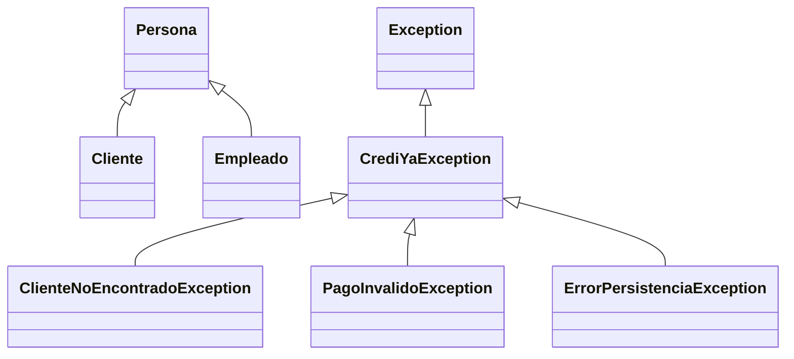
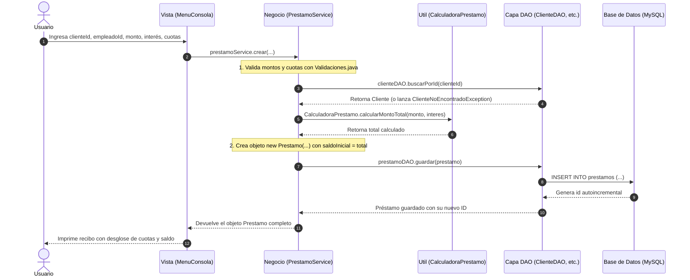

# 📚 GUÍA DE REPASO GENERAL — CrediYa S.A.S.
### Preparación para Examen de Java: Programación Orientada a Objetos, Arquitectura y Código

Este documento está diseñado como una guía de estudio integral basada **100 % en el código real de este proyecto**. Explica los conceptos clave de Java, cómo funciona cada clase, para qué sirve cada componente y cómo se conectan todas las piezas entre sí.

---

## 📑 Tabla de Contenidos
1. [Conceptos Clave de POO y Java (Con Ejemplos del Código)](#1-conceptos-clave-de-poo-y-java-con-ejemplos-del-código)
   - [¿Para qué sirve `super`?](#-para-qué-sirve-super)
   - [¿Para qué sirve `this`?](#-para-qué-sirve-this)
   - [Herencia (`extends`)](#-herencia-extends)
   - [Clases Abstractas vs. Interfaces](#-clases-abstractas-vs-interfaces)
   - [Polimorfismo y `@Override`](#-polimorfismo-y-override)
   - [Encapsulamiento y Modificadores de Acceso](#-encapsulamiento-y-modificadores-de-acceso)
   - [La palabra clave `final`](#-la-palabra-clave-final)
2. [¿Para qué sirve cada cosa? (Estructura de Paquetes y Clases)](#2-para-qué-sirve-cada-cosa-estructura-de-paquetes-y-clases)
   - [com.crediya.modelo](#-paquete-comcrediyamodelo)
   - [com.crediya.dao](#-paquete-comcrediyadao)
   - [com.crediya.persistencia](#-paquete-comcrediyapersistencia)
   - [com.crediya.servicio](#-paquete-comcrediyaservicio)
   - [com.crediya.excepciones](#-paquete-comcrediyaexcepciones)
   - [com.crediya.util](#-paquete-comcrediyautil)
   - [com.crediya.vista y Main](#-paquete-comcrediyavista-y-mainjava)
3. [Cosas Juntadas: ¿Cómo interactúan las piezas?](#3-cosas-juntadas-cómo-interactúan-las-piezas)
   - [Flujo 1: Crear un Préstamo](#flujo-1-crear-un-préstamo-paso-a-paso)
   - [Flujo 2: Registrar un Pago con Transacción (Commit y Rollback)](#flujo-2-registrar-un-pago-con-transacción-commit-y-rollback)
   - [Flujo 3: El Flujo Arquitectónico en Capas](#flujo-3-el-flujo-arquitectónico-en-capas)
4. [Técnicas Modernas de Java en el Proyecto](#4-técnicas-modernas-de-java-en-el-proyecto)
   - [Manejo de Errores y Excepciones Personalizadas](#-manejo-de-errores-y-excepciones-personalizadas)
   - [`Optional<T>` y `.orElseThrow(...)`](#-optionalt-y-orelsethrow)
   - [Stream API y Expresiones Lambda](#-stream-api-y-expresiones-lambda)
   - [JDBC Seguro y `try-with-resources`](#-jdbc-seguro-y-try-with-resources)
   - [Patrones de Diseño: Singleton y DAO](#-patrones-de-diseño-singleton-y-dao)
5. [Banco de Preguntas Típicas de Examen](#5-banco-de-preguntas-típicas-de-examen)

---

## 1. Conceptos Clave de POO y Java (Con Ejemplos del Código)

### 🔹 ¿Para qué sirve `super`?

La palabra reservada `super` se refiere a la **superclase (la clase padre)** de la clase actual. En este proyecto tiene **dos usos fundamentales**:

#### 1. Invocar el constructor del padre: `super(...)`
Cuando una clase hija hereda de un padre, el constructor de la hija debe inicializar primero los atributos del padre.

> **Ejemplo en el proyecto ([`Cliente.java`](file:///c:/Users/Pc_Ruben/Documents/NetBeansProjects/Examen_Java_Ruben/src/main/java/com/crediya/modelo/Cliente.java#L8-L11)):**
```java
public class Cliente extends Persona {
    private String telefono;

    public Cliente(int id, String nombre, String documento, String correo, String telefono) {
        // Llama al constructor de Persona(id, nombre, documento, correo)
        super(id, nombre, documento, correo); 
        this.telefono = telefono; // Atributo propio de Cliente
    }
}
```
* **¿Por qué se hace así?** Porque `Persona` ya sabe cómo guardar `id`, `nombre`, `documento` y `correo`. No repetimos código; le delegamos esa tarea al padre con `super(...)`.
* **Regla estricta:** La llamada a `super(...)` debe ser obligatoriamente la **primera línea** del constructor de la clase hija.

> **Ejemplo en excepciones ([`CrediYaException.java`](file:///c:/Users/Pc_Ruben/Documents/NetBeansProjects/Examen_Java_Ruben/src/main/java/com/crediya/excepciones/CrediYaException.java#L9-L15)):**
```java
public class CrediYaException extends Exception {
    public CrediYaException(String mensaje) {
        super(mensaje); // Pasa el mensaje de error al constructor de java.lang.Exception
    }

    public CrediYaException(String mensaje, Throwable causa) {
        super(mensaje, causa); // Pasa mensaje y la causa original (ej. SQLException)
    }
}
```

#### 2. Reutilizar un método del padre que fue sobrescrito: `super.metodo()`
Si la clase hija sobrescribe (`@Override`) un método del padre, pero quiere incluir lo que el padre ya hacía y añadirle más información, usa `super.nombreMetodo()`.

> **Ejemplo en el proyecto ([`Cliente.java`](file:///c:/Users/Pc_Ruben/Documents/NetBeansProjects/Examen_Java_Ruben/src/main/java/com/crediya/modelo/Cliente.java#L27-L29)):**
```java
@Override
public String toString() {
    // super.toString() devuelve: "Cliente #1 | Carlos Gomez | Doc: 10101 | carlos@mail.com"
    // Y le agregamos el teléfono:
    return super.toString() + " | Tel: " + telefono;
}
```

---

### 🔹 ¿Para qué sirve `this`?

La palabra reservada `this` hace referencia a la **instancia actual del objeto**. Se usa principalmente para **diferenciar atributos de parámetros** cuando tienen el mismo nombre.

> **Ejemplo en [`Persona.java`](file:///c:/Users/Pc_Ruben/Documents/NetBeansProjects/Examen_Java_Ruben/src/main/java/com/crediya/modelo/Persona.java#L16-L21):**
```java
protected Persona(int id, String nombre, String documento, String correo) {
    this.id = id;               // this.id es el atributo de la clase; id es el parámetro recibido
    this.nombre = nombre;       // this.nombre es el atributo; nombre es el parámetro
    this.documento = documento;
    this.correo = correo;
}
```
Sin `this.`, escribir `nombre = nombre;` solo asignaría el parámetro a sí mismo, dejando el atributo vacío.

---

### 🔹 Herencia (`extends`)

La herencia permite crear nuevas clases que reutilizan atributos y métodos de una clase existente, promoviendo el principio **DRY (Don't Repeat Yourself)**.



* Tanto `Cliente` como `Empleado` son personas: tienen cédula, nombre, correo e ID.
* En lugar de duplicar esos campos en las dos clases, se declaran en [`Persona`](file:///c:/Users/Pc_Ruben/Documents/NetBeansProjects/Examen_Java_Ruben/src/main/java/com/crediya/modelo/Persona.java) y ambas heredan con `extends Persona`.

---

### 🔹 Clases Abstractas vs. Interfaces

En el examen es muy común que pregunten: **¿Cuándo usar una clase abstracta y cuándo una interfaz?** En este proyecto se usaron ambas, cada una con un propósito claro:

| Característica | Clase Abstracta (`Persona`) | Interfaz (`Guardable<T>`, `Consultable<T>`) |
|---|---|---|
| **Definición** | Modela **lo que un objeto ES** (relación "es un"). | Modela **lo que un objeto PUEDE HACER** (habilidad o contrato). |
| **Herencia** | Simple: una clase solo puede heredar de **una** clase abstracta (`extends Persona`). | Múltiple: una clase puede implementar **muchas** interfaces (`implements Guardable<T>, Consultable<T>`). |
| **Estado (atributos)** | Puede tener atributos de instancia (`id`, `nombre`, `correo`). | Solo constantes (`public static final`). |
| **Constructores** | Sí tiene constructor (usado por las clases hijas vía `super`). | No tiene constructores. |

#### Ejemplo en el código:
* **Clase Abstracta [`Persona.java`](file:///c:/Users/Pc_Ruben/Documents/NetBeansProjects/Examen_Java_Ruben/src/main/java/com/crediya/modelo/Persona.java):**
  Nadie puede hacer `new Persona(...)` porque una persona "genérica" no existe en el negocio; solo existen clientes o empleados. Por eso es `abstract`.
* **Interfaces Pequeñas ([`Guardable.java`](file:///c:/Users/Pc_Ruben/Documents/NetBeansProjects/Examen_Java_Ruben/src/main/java/com/crediya/dao/Guardable.java), [`Consultable.java`](file:///c:/Users/Pc_Ruben/Documents/NetBeansProjects/Examen_Java_Ruben/src/main/java/com/crediya/dao/Consultable.java), [`Modificable.java`](file:///c:/Users/Pc_Ruben/Documents/NetBeansProjects/Examen_Java_Ruben/src/main/java/com/crediya/dao/Modificable.java)):**
  Siguen el principio **ISP (Interface Segregation Principle)**.
  - `ClienteDAO` implementa las 3 interfaces (se puede guardar, consultar, editar y borrar).
  - `PagoDAO` solo implementa `Guardable` y `Consultable`. **Un pago no se modifica ni se elimina** (por auditoría contable), así que no implementa `Modificable`. ¡Esa es la ventaja de tener interfaces separadas!

---

### 🔹 Polimorfismo y `@Override`

Polimorfismo significa **"muchas formas"**: el mismo método responde de manera distinta según el objeto que lo ejecute en tiempo de ejecución.

1. **Método abstracto polimórfico en [`Persona.java`](file:///c:/Users/Pc_Ruben/Documents/NetBeansProjects/Examen_Java_Ruben/src/main/java/com/crediya/modelo/Persona.java#L56):**
   ```java
   public abstract String getTipo();
   ```
2. **Implementación en [`Cliente.java`](file:///c:/Users/Pc_Ruben/Documents/NetBeansProjects/Examen_Java_Ruben/src/main/java/com/crediya/modelo/Cliente.java#L21-L24):**
   ```java
   @Override
   public String getTipo() {
       return "Cliente";
   }
   ```
3. **Implementación en [`Empleado.java`](file:///c:/Users/Pc_Ruben/Documents/NetBeansProjects/Examen_Java_Ruben/src/main/java/com/crediya/modelo/Empleado.java#L33-L36):**
   ```java
   @Override
   public String getTipo() {
       return "Empleado";
   }
   ```
4. **¿Por qué sirve?** En el `toString()` de `Persona` se llama a `getTipo()`. Si el objeto en memoria es un `Cliente`, llamará al de `Cliente`. Si es un `Empleado`, llamará al de `Empleado`. No se requiere ningún `if-else`.

---

### 🔹 Encapsulamiento y Modificadores de Acceso

El encapsulamiento protege el estado interno de un objeto para que no sea modificado arbitrariamente desde fuera.

* `private`: Solo accesible dentro de la misma clase (ej. `private double saldoPendiente;`).
* `protected`: Accesible en la misma clase, sus subclases y el mismo paquete (ej. el constructor `protected Persona(...)` solo lo pueden invocar `Cliente` y `Empleado`).
* `public`: Accesible desde cualquier lugar del proyecto.
* **Getters y Setters:** Permiten leer o modificar los valores bajo control.

---

### 🔹 La palabra clave `final`

En Java, `final` tiene tres significados según dónde se coloque:

1. **En una variable/atributo:** Es constante, no puede reasignarse después de recibir un valor.
   > En [`Prestamo.java`](file:///c:/Users/Pc_Ruben/Documents/NetBeansProjects/Examen_Java_Ruben/src/main/java/com/crediya/modelo/Prestamo.java#L14): `private final double monto;` (el monto inicial pactado nunca cambia).
2. **En una clase:** No se puede heredar de ella.
   > En [`CalculadoraPrestamo.java`](file:///c:/Users/Pc_Ruben/Documents/NetBeansProjects/Examen_Java_Ruben/src/main/java/com/crediya/util/CalculadoraPrestamo.java#L14): `public final class CalculadoraPrestamo` (es una clase de utilidades pura, no debe tener subclases).
3. **En un método:** No puede ser sobrescrito por clases hijas.

---

## 2. ¿Para qué sirve cada cosa? (Estructura de Paquetes y Clases)

El proyecto está organizado en **arquitectura por capas**, donde cada paquete tiene una responsabilidad única y bien delimitada:

```
src/main/java/com/crediya/
│
├── modelo/          --> Objetos del negocio (datos y estado)
├── dao/             --> Acceso a la base de datos MySQL (SQL directo)
├── persistencia/    --> Conexión JDBC (Singleton) y Archivos .txt
├── servicio/        --> Lógica del negocio, validaciones y cálculos
├── excepciones/     --> Errores controlados del sistema
├── util/            --> Clases de apoyo (cálculos, formatos, regex)
├── vista/           --> Interfaz de usuario (Consola, Scanner)
└── Main.java        --> Ensamblador del sistema (inyección de dependencias)
```

---

### 📦 Paquete `com.crediya.modelo`
Contiene las clases que representan los conceptos centrales del negocio:

| Clase / Archivo | ¿Para qué sirve? |
|---|---|
| [`Persona.java`](file:///c:/Users/Pc_Ruben/Documents/NetBeansProjects/Examen_Java_Ruben/src/main/java/com/crediya/modelo/Persona.java) | Clase abstracta base. Centraliza los datos comunes de cualquier persona (`id`, `nombre`, `documento`, `correo`). |
| [`Cliente.java`](file:///c:/Users/Pc_Ruben/Documents/NetBeansProjects/Examen_Java_Ruben/src/main/java/com/crediya/modelo/Cliente.java) | Representa a quien solicita el préstamo. Hereda de `Persona` y agrega `telefono`. |
| [`Empleado.java`](file:///c:/Users/Pc_Ruben/Documents/NetBeansProjects/Examen_Java_Ruben/src/main/java/com/crediya/modelo/Empleado.java) | Representa a quien gestiona o aprueba el préstamo. Hereda de `Persona` y agrega `rol` y `salario`. |
| [`Prestamo.java`](file:///c:/Users/Pc_Ruben/Documents/NetBeansProjects/Examen_Java_Ruben/src/main/java/com/crediya/modelo/Prestamo.java) | La entidad principal. Contiene el cliente, el empleado, monto, interés, cuotas, saldo pendiente, estado y la lógica para saber si **está en mora**. |
| [`Pago.java`](file:///c:/Users/Pc_Ruben/Documents/NetBeansProjects/Examen_Java_Ruben/src/main/java/com/crediya/modelo/Pago.java) | Representa un abono registrado a un préstamo (`id`, `prestamoId`, `fechaPago`, `monto`). |
| [`EstadoPrestamo.java`](file:///c:/Users/Pc_Ruben/Documents/NetBeansProjects/Examen_Java_Ruben/src/main/java/com/crediya/modelo/EstadoPrestamo.java) | Enumeración (`enum`) con los 3 estados válidos: `PENDIENTE`, `PAGADO`, `VENCIDO`. Evita errores tipográficos como escribir `"pagado"` o `"PAGADA"`. |

---

### 📦 Paquete `com.crediya.dao`
**DAO = Data Access Object (Objeto de Acceso a Datos).**  
Es la **única** capa autorizada para ejecutar sentencias SQL (`SELECT`, `INSERT`, `UPDATE`, `DELETE`). Si cambiamos la base de datos mañana, solo tocamos este paquete.

| Clase / Interfaz | ¿Para qué sirve? |
|---|---|
| [`Guardable<T>`](file:///c:/Users/Pc_Ruben/Documents/NetBeansProjects/Examen_Java_Ruben/src/main/java/com/crediya/dao/Guardable.java) | Interfaz genérica con el método `void guardar(T entidad)`. |
| [`Consultable<T>`](file:///c:/Users/Pc_Ruben/Documents/NetBeansProjects/Examen_Java_Ruben/src/main/java/com/crediya/dao/Consultable.java) | Interfaz genérica con `List<T> listar()` y `Optional<T> buscarPorId(int id)`. |
| [`Modificable<T>`](file:///c:/Users/Pc_Ruben/Documents/NetBeansProjects/Examen_Java_Ruben/src/main/java/com/crediya/dao/Modificable.java) | Interfaz genérica con `actualizar(T entidad)` y `eliminar(int id)`. |
| [`ClienteDAO.java`](file:///c:/Users/Pc_Ruben/Documents/NetBeansProjects/Examen_Java_Ruben/src/main/java/com/crediya/dao/ClienteDAO.java) | Inserta, actualiza, elimina y consulta clientes en la tabla `clientes`. Valida búsquedas por ID y documento. |
| [`EmpleadoDAO.java`](file:///c:/Users/Pc_Ruben/Documents/NetBeansProjects/Examen_Java_Ruben/src/main/java/com/crediya/dao/EmpleadoDAO.java) | Inserta, actualiza, elimina y consulta empleados en la tabla `empleados`. |
| [`PrestamoDAO.java`](file:///c:/Users/Pc_Ruben/Documents/NetBeansProjects/Examen_Java_Ruben/src/main/java/com/crediya/dao/PrestamoDAO.java) | Inserta préstamos, actualiza saldos y estados, y hace consultas con `JOIN` a clientes y empleados para reconstruir el objeto completo. |
| [`PagoDAO.java`](file:///c:/Users/Pc_Ruben/Documents/NetBeansProjects/Examen_Java_Ruben/src/main/java/com/crediya/dao/PagoDAO.java) | Inserta pagos en la tabla `pagos` y maneja la **transacción combinada** de registrar pago y actualizar saldo. |

---

### 📦 Paquete `com.crediya.persistencia`
Maneja los medios de almacenamiento físicos (la base de datos y los archivos en disco):

| Clase | ¿Para qué sirve? |
|---|---|
| [`ConexionBD.java`](file:///c:/Users/Pc_Ruben/Documents/NetBeansProjects/Examen_Java_Ruben/src/main/java/com/crediya/persistencia/ConexionBD.java) | Implementa el **Patrón Singleton**. Lee una sola vez el archivo `src/main/resources/db.properties` y proporciona el método `getConexion()` para abrir conexiones a MySQL. Traduce códigos de error técnicos de MySQL a mensajes claros en español. |
| [`ArchivoService.java`](file:///c:/Users/Pc_Ruben/Documents/NetBeansProjects/Examen_Java_Ruben/src/main/java/com/crediya/persistencia/ArchivoService.java) | Sistema de respaldo local en archivos de texto plano (`.txt` separados por punto y coma `;`) dentro de la carpeta `datos/`. Lee y escribe empleados, clientes, préstamos y pagos usando el paquete `java.nio.file.Files`. |

---

### 📦 Paquete `com.crediya.servicio`
**Capa de Negocio.** Contiene las reglas operativas de CrediYa. Conecta la vista con los DAO: no hace SQL ni imprime en consola.

| Clase | ¿Para qué sirve? |
|---|---|
| [`ClienteService.java`](file:///c:/Users/Pc_Ruben/Documents/NetBeansProjects/Examen_Java_Ruben/src/main/java/com/crediya/servicio/ClienteService.java) | Valida datos del cliente, verifica que el documento no esté duplicado y controla que **no se pueda eliminar un cliente si tiene préstamos activos o registrados**. |
| [`EmpleadoService.java`](file:///c:/Users/Pc_Ruben/Documents/NetBeansProjects/Examen_Java_Ruben/src/main/java/com/crediya/servicio/EmpleadoService.java) | Valida salarios, roles y documentos únicos para empleados. Bloquea la eliminación de empleados vinculados a préstamos. |
| [`PrestamoService.java`](file:///c:/Users/Pc_Ruben/Documents/NetBeansProjects/Examen_Java_Ruben/src/main/java/com/crediya/servicio/PrestamoService.java) | Calcula el total a pagar inicial, valida montos e intereses, crea el préstamo en estado `PENDIENTE` y valida que solo se marque `PAGADO` si el saldo es cero. |
| [`PagoService.java`](file:///c:/Users/Pc_Ruben/Documents/NetBeansProjects/Examen_Java_Ruben/src/main/java/com/crediya/servicio/PagoService.java) | Valida que el pago no supere el saldo pendiente, calcula el nuevo saldo y, si el saldo llega a $0, cambia automáticamente el estado a `PAGADO`. Invoca la transacción en el DAO. |
| [`ReporteService.java`](file:///c:/Users/Pc_Ruben/Documents/NetBeansProjects/Examen_Java_Ruben/src/main/java/com/crediya/servicio/ReporteService.java) | Genera los 7 reportes financieros usando **Streams y Lambdas**: total de cartera, suma de abonos, morosos, préstamos por empleado y por cliente. |
| [`PersistenciaService.java`](file:///c:/Users/Pc_Ruben/Documents/NetBeansProjects/Examen_Java_Ruben/src/main/java/com/crediya/servicio/PersistenciaService.java) | Orquesta la exportación/importación entre MySQL y los archivos de texto `.txt`. |

---

### 📦 Paquete `com.crediya.excepciones`
Define la jerarquía de errores propios de la aplicación. Todas heredan de [`CrediYaException`](file:///c:/Users/Pc_Ruben/Documents/NetBeansProjects/Examen_Java_Ruben/src/main/java/com/crediya/excepciones/CrediYaException.java):

* [`ClienteNoEncontradoException`](file:///c:/Users/Pc_Ruben/Documents/NetBeansProjects/Examen_Java_Ruben/src/main/java/com/crediya/excepciones/ClienteNoEncontradoException.java): Al buscar un ID o documento inexistente.
* [`EmpleadoNoEncontradoException`](file:///c:/Users/Pc_Ruben/Documents/NetBeansProjects/Examen_Java_Ruben/src/main/java/com/crediya/excepciones/EmpleadoNoEncontradoException.java): Al buscar un empleado que no existe.
* [`PrestamoNoEncontradoException`](file:///c:/Users/Pc_Ruben/Documents/NetBeansProjects/Examen_Java_Ruben/src/main/java/com/crediya/excepciones/PrestamoNoEncontradoException.java): Si no existe el préstamo consultado.
* [`PagoInvalidoException`](file:///c:/Users/Pc_Ruben/Documents/NetBeansProjects/Examen_Java_Ruben/src/main/java/com/crediya/excepciones/PagoInvalidoException.java): Cuando un abono supera el saldo pendiente o el préstamo ya estaba pagado.
* [`DatosInvalidosException`](file:///c:/Users/Pc_Ruben/Documents/NetBeansProjects/Examen_Java_Ruben/src/main/java/com/crediya/excepciones/DatosInvalidosException.java): Correos con formato erróneo, cédulas con letras, valores negativos.
* [`ErrorPersistenciaException`](file:///c:/Users/Pc_Ruben/Documents/NetBeansProjects/Examen_Java_Ruben/src/main/java/com/crediya/excepciones/ErrorPersistenciaException.java): Envuelve fallos de `SQLException` o `IOException`.

---

### 📦 Paquete `com.crediya.util`
Clases auxiliares con métodos `public static` para no ensuciar las demás clases:

* [`CalculadoraPrestamo.java`](file:///c:/Users/Pc_Ruben/Documents/NetBeansProjects/Examen_Java_Ruben/src/main/java/com/crediya/util/CalculadoraPrestamo.java): Fórmulas de negocio (valor de interés, monto total, cuota mensual y redondeo a 2 decimales con `Math.round`).
* [`Validaciones.java`](file:///c:/Users/Pc_Ruben/Documents/NetBeansProjects/Examen_Java_Ruben/src/main/java/com/crediya/util/Validaciones.java): Expresiones regulares (`Pattern`) para cédulas, correos y teléfonos, además de rangos de montos y cuotas.
* [`Formato.java`](file:///c:/Users/Pc_Ruben/Documents/NetBeansProjects/Examen_Java_Ruben/src/main/java/com/crediya/util/Formato.java): Da formato visual de moneda colombiana (`$ 1.500.000`) usando `NumberFormat` con `Locale("es", "CO")`.

---

### 📦 Paquete `com.crediya.vista` y `Main.java`

* [`MenuConsola.java`](file:///c:/Users/Pc_Ruben/Documents/NetBeansProjects/Examen_Java_Ruben/src/main/java/com/crediya/vista/MenuConsola.java): Es la cara visible para el usuario. Contiene los menús interactivos, lee datos con `Scanner` y muestra tablas y mensajes. **No contiene sentencias SQL ni fórmulas de crédito**. Captura las excepciones de negocio y muestra mensajes amigables como `[ERROR] El monto debe ser mayor a cero` sin que el programa se cuelgue.
* [`Main.java`](file:///c:/Users/Pc_Ruben/Documents/NetBeansProjects/Examen_Java_Ruben/src/main/java/com/crediya/Main.java): El punto de arranque (`public static void main`). Su única misión es **crear las instancias de cada capa y pasárselas unas a otras (Inyección de Dependencias manual)** y finalmente llamar a `menu.iniciar()`.

---

## 3. Cosas Juntadas: ¿Cómo interactúan las piezas?

Para un examen es vital entender **el viaje de los datos** a través de las capas.

### Flujo 1: Crear un Préstamo (Paso a Paso)



---

### Flujo 2: Registrar un Pago con Transacción (Commit y Rollback)

Cuando un cliente hace un abono, ocurren **dos acciones en la base de datos** al mismo tiempo:
1. Se guarda un registro en la tabla `pagos`.
2. Se actualiza el `saldo_pendiente` y el `estado` en la tabla `prestamos`.

¿Qué pasaría si la primera acción funciona pero la segunda falla por un corte de red?  
Quedaría un pago registrado pero el saldo del cliente nunca bajaría. Para evitarlo, en [`PagoDAO.java`](file:///c:/Users/Pc_Ruben/Documents/NetBeansProjects/Examen_Java_Ruben/src/main/java/com/crediya/dao/PagoDAO.java#L40-L61) se usa una **Transacción ACID manual**:

```java
try (Connection con = ConexionBD.getInstancia().getConexion()) {
    try {
        con.setAutoCommit(false); // 1. Desactiva el autoguardado (inicia transacción)
        
        insertar(con, pago);      // 2. Inserta el pago en la tabla "pagos"

        // 3. Actualiza el préstamo en la tabla "prestamos"
        try (PreparedStatement ps = con.prepareStatement(
                "UPDATE prestamos SET saldo_pendiente = ?, estado = ? WHERE id = ?")) {
            ps.setDouble(1, nuevoSaldo);
            ps.setString(2, nuevoEstado.name());
            ps.setInt(3, pago.getPrestamoId());
            ps.executeUpdate();
        }

        con.commit(); // 4. TODO SALIÓ BIEN: consolida ambos cambios permanentemente
    } catch (SQLException ex) {
        con.rollback(); // 5. ALGO FALLÓ: deshace cualquier cambio previo, la BD queda limpia
        throw ex;
    }
}
```

---

### Flujo 3: El Flujo Arquitectónico en Capas

Este proyecto sigue una estricta jerarquía de dependencias:

```
[ Vista (MenuConsola) ]
         │ (Pide datos al usuario y llama al servicio)
         ▼
[ Servicio (PrestamoService, PagoService, etc.) ]
         │ (Valida reglas de negocio, calcula fórmulas)
         ▼
[ DAO (PrestamoDAO, PagoDAO, etc.) ]
         │ (Prepara consultas SQL con JDBC)
         ▼
[ Persistencia (ConexionBD - MySQL / ArchivoService - .txt) ]
```

* **Regla de oro:** La capa superior conoce a la inferior, pero la inferior **nunca** conoce a la superior.
  - El DAO no sabe si existe una consola o una página web.
  - La entidad `Prestamo` no sabe si está guardada en MySQL o en un archivo `.txt`.
  - El menú no sabe qué consulta SQL se utiliza para buscar un cliente.

---

## 4. Técnicas Modernas de Java en el Proyecto

### 🔹 Manejo de Errores y Excepciones Personalizadas

En lugar de lanzar excepciones genéricas como `RuntimeException` o dejar escapar un `SQLException`, el sistema traduce cualquier problema a una excepción del dominio:

```java
// En MenuConsola.java:
private void ejecutar(Accion accion) {
    try {
        accion.ejecutar();
    } catch (CrediYaException e) {
        System.out.println("\n[ERROR] " + e.getMessage());
    }
}
```
* **Ventaja:** Gracias al polimorfismo de excepciones, capturar la clase base `CrediYaException` intercepta automáticamente cualquiera de sus 6 subclases (`PagoInvalidoException`, `ClienteNoEncontradoException`, etc.). El programa **nunca explota abruptamente**, sino que le informa con calma al usuario qué corregir.

---

### 🔹 `Optional<T>` y `.orElseThrow(...)`

En Java moderno (desde Java 8), en vez de devolver `null` cuando no se encuentra un registro en la base de datos, los métodos de búsqueda devuelven un `Optional<T>`.

> **Ejemplo en [`PrestamoService.java`](file:///c:/Users/Pc_Ruben/Documents/NetBeansProjects/Examen_Java_Ruben/src/main/java/com/crediya/servicio/PrestamoService.java#L43-L44):**
```java
Cliente cliente = clienteDAO.buscarPorId(clienteId)
        .orElseThrow(() -> new ClienteNoEncontradoException("No existe un cliente con ID " + clienteId + "."));
```
* Si el cliente existe, `orElseThrow` desenvuelve y devuelve el objeto `Cliente`.
* Si no existe, lanza la excepción `ClienteNoEncontradoException` inmediatamente. Esto **elimina por completo los temidos errores de `NullPointerException`**.

---

### 🔹 Stream API y Expresiones Lambda

En [`ReporteService.java`](file:///c:/Users/Pc_Ruben/Documents/NetBeansProjects/Examen_Java_Ruben/src/main/java/com/crediya/servicio/ReporteService.java) se procesan los datos con la API de Streams en lugar de llenar el código de bucles `for` tradicionales:

#### 1. Filtrar con predicados y referencias a métodos:
```java
public List<Prestamo> prestamosEnMora() throws ErrorPersistenciaException {
    return prestamoDAO.listar().stream()
            .filter(Prestamo::estaEnMora) // Referencia a método: evalúa la regla de mora
            .toList();
}
```

#### 2. Sumar valores numéricos (`mapToDouble` y `sum`):
```java
public double totalCartera() throws ErrorPersistenciaException {
    return prestamoDAO.listar().stream()
            .mapToDouble(Prestamo::getSaldoPendiente)
            .sum();
}
```

#### 3. Agrupación avanzada (`groupingBy`):
```java
public Map<String, Long> prestamosPorEmpleado() throws ErrorPersistenciaException {
    return prestamoDAO.listar().stream()
            .collect(Collectors.groupingBy(
                    p -> p.getEmpleado().getNombre() + " (ID " + p.getEmpleado().getId() + ")",
                    TreeMap::new,           // Lo ordena alfabéticamente
                    Collectors.counting())); // Cuenta cuántos préstamos tiene cada uno
}
```

---

### 🔹 JDBC Seguro y `try-with-resources`

#### 1. Prevención de Inyección SQL
Nunca se concatenan cadenas directas en las sentencias SQL (como `"WHERE id = " + id`). Siempre se utiliza `PreparedStatement` con signos de interrogación `?`:
```java
String sql = "SELECT * FROM clientes WHERE documento = ?";
PreparedStatement ps = con.prepareStatement(sql);
ps.setString(1, documento);
```

#### 2. Cierre automático de recursos (`try-with-resources`)
Cualquier clase que implemente `AutoCloseable` (como `Connection`, `PreparedStatement`, `ResultSet`, `InputStream`) puede ponerse dentro del paréntesis del `try (...)`:
```java
try (Connection con = ConexionBD.getInstancia().getConexion();
     PreparedStatement ps = con.prepareStatement(sql);
     ResultSet rs = ps.executeQuery()) {
    // Usar la conexión...
} // Al llegar a esta llave, Java CIERRA AUTOMÁTICAMENTE rs, ps y con,
  // incluso si ocurrió un error o excepción. Evita fugas de memoria y bloqueos en MySQL.
```

---

### 🔹 Patrones de Diseño: Singleton y DAO

* **Singleton ([`ConexionBD.java`](file:///c:/Users/Pc_Ruben/Documents/NetBeansProjects/Examen_Java_Ruben/src/main/java/com/crediya/persistencia/ConexionBD.java)):**
  - **Constructor privado:** `private ConexionBD() { ... }` para que nadie pueda hacer `new ConexionBD()`.
  - **Instancia estática única:** `private static ConexionBD instancia;`.
  - **Punto de acceso global sincronizado:** `public static synchronized ConexionBD getInstancia()`.
  - **Para qué sirve:** Evita volver a leer el archivo `db.properties` del disco duro cada vez que se requiere una conexión; la configuración se carga en memoria una sola vez.

* **DAO (Data Access Object):**
  - Encapsula toda la interacción con la base de datos. Los objetos del modelo (`Cliente`, `Prestamo`) permanecen limpios y libres de código JDBC.

---

## 5. Banco de Preguntas Típicas de Examen

### ❓ 1. ¿Cuál es la diferencia entre `super()` y `this()`?
* **`super()`** invoca al constructor de la clase padre (superclase), por ejemplo cuando `Cliente` le envía el nombre y documento a `Persona`.
* **`this()`** invoca a otro constructor dentro de la **misma clase**.
* Ambos deben ser siempre la primera sentencia del constructor.

### ❓ 2. ¿Por qué `Persona` es una clase abstracta y no una clase normal?
Porque en el modelo de negocio de CrediYa no existen "personas genéricas"; todo usuario en el sistema es o bien un `Cliente` o un `Empleado`. Al ser abstracta, se previene que alguien haga erróneamente `new Persona(...)`, obligando a instanciar las clases concretas que implementan el método abstracto `getTipo()`.

### ❓ 3. ¿Por qué `CalculadoraPrestamo` tiene un constructor privado?
Porque es una clase utilitaria compuesta exclusivamente de métodos estáticos (`public static`). No tiene estado ni atributos de instancia; instanciar un objeto `CalculadoraPrestamo calc = new CalculadoraPrestamo();` no tendría ningún sentido. El constructor privado previene su instanciación accidental.

### ❓ 4. ¿Qué es una transacción en base de datos y cómo se implementó en el proyecto?
Una transacción agrupa múltiples operaciones en una unidad de trabajo atómica (todo o nada). En `PagoDAO.registrarPagoYActualizarPrestamo`, se hace `con.setAutoCommit(false)`. Si la inserción del pago y la actualización del saldo se completan con éxito, se ejecuta `con.commit()`. Si alguna de las dos falla, se captura el error y se ejecuta `con.rollback()`, restaurando el estado original de la base de datos.

### ❓ 5. ¿Por qué se prefiere `PreparedStatement` sobre `Statement`?
1. **Seguridad:** Evita ataques de inyección SQL (SQL Injection), ya que los parámetros se envían parametrizados y tipados, no como texto concatenado.
2. **Rendimiento:** El motor de MySQL compila el plan de ejecución de la consulta una sola vez y lo reutiliza cuando cambian los parámetros.

### ❓ 6. ¿Qué beneficios tiene la inyección de dependencias en `Main.java`?
En `Main`, los DAOs se crean primero y luego se pasan a los Servicios por su constructor (`new PrestamoService(prestamoDAO, clienteDAO, empleadoDAO)`). Esto desacopla las clases: `PrestamoService` no tiene la responsabilidad de crear o configurar los DAOs, lo que facilita cambiar la base de datos o realizar pruebas unitarias en el futuro sin modificar la lógica de negocio.

---

> 💡 **Consejo para el examen:** Cuando te pregunten por cualquier concepto de POO (herencia, polimorfismo, interfaces, encapsulamiento), responde **definiendo el concepto en una frase** y de inmediato da **el ejemplo concreto de este proyecto** (por ejemplo: *"Polimorfismo es la capacidad de responder a un mismo mensaje de diferentes formas; en nuestro proyecto, el método abstracto `getTipo()` en `Persona` devuelve 'Cliente' para clientes y 'Empleado' para empleados"*). ¡Eso demuestra dominio total del código!
